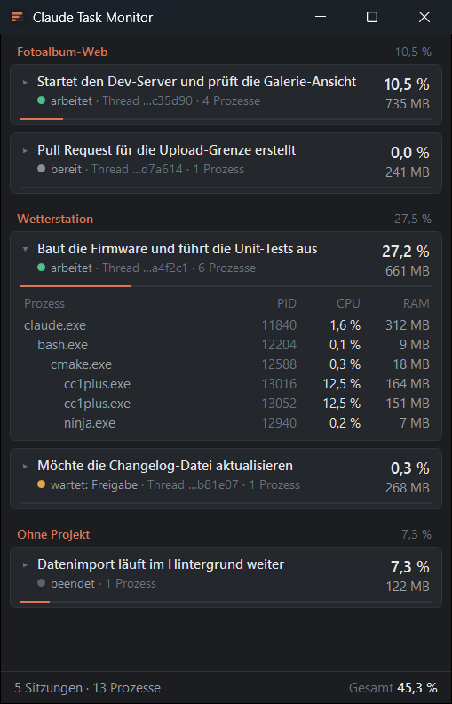

<p align="center">
  
</p>

<p align="center">
  <b>🇬🇧 English version: <a href="#claude-task-monitor-english">see below</a></b>
</p>

# Claude Task Monitor

Ein kleines Windows-Tool, das immer im Vordergrund bleibt (Stay-on-top). Es zeigt die Prozesse, die Claude gerade angestoßen hat, mit ihrer CPU-Last an. Erfasst werden die Claude-Desktop-App (auch Cowork und Remote Control) und Claude Code. Die Prozesse sind nach Claude-Projekt und Sitzung gruppiert. So sieht man auf einen Blick, welcher Claude-Thread gerade welche Last erzeugt, etwa einen Build, Tests oder ein hängendes Skript.

<p align="center">
  
</p>

<sub>Der Screenshot zeigt erfundene Beispieldaten aus dem Demo-Modus (siehe [Demo-Modus](#demo-modus)).</sub>

## Installation

Unter [Releases](../../releases) liegt `ClaudeTaskMonitor.exe` als einzelne Datei. Sie braucht die **.NET 10 Desktop Runtime (x64)**. Eine Installation ist nicht nötig: einfach die exe starten.

## Bedienung

- **Fenster:** schmal, immer im Vordergrund, frei verschieb- und skalierbar.
- **Projekte:** Die Sitzungen sind nach Claude-Projekt gruppiert. Sitzungen ohne Projekt stehen unter „Ohne Projekt“.
- **Karte je Sitzung:**
  - Zeile 1 zeigt die Kurz-Zusammenfassung des letzten Zugs, ersatzweise den Titel oder den Sitzungsnamen.
  - Zeile 2 zeigt Status (arbeitet / bereit / wartet / beendet), die Thread-Kurzform und die Prozesszahl.
  - Rechts stehen CPU-Last und RAM der ganzen Sitzung.
  - Beim Überfahren mit der Maus erscheinen Details wie Ordner, Sitzungs-ID und letzte Aktivität.
- **Klick** auf eine Karte klappt den Prozessbaum mit CPU-Last und RAM je Prozess auf. Prozesse, deren Elternprozess beendet ist, bleiben als „verwaist“ bei ihrer Sitzung.
- **Doppelklick** auf eine Karte öffnet den Thread im Browser (`https://claude.ai/code/project/<chan>?thread=<cmsg>`). Das geht nur, wenn Projekt und Thread bekannt sind.
- **Rechtsklick** öffnet das Kontextmenü mit diesen Einträgen:
  - Thread im Browser öffnen
  - Thread-Link kopieren
  - Immer im Vordergrund an/aus
  - Aktualisieren alle 1 / 2 / 5 Sekunden (Standard: 2 s)
  - Sprache: Automatisch / Deutsch / English
  - Beenden
- **Minimiert** tastet das Tool nicht ab und braucht keine CPU.
- Die CPU-Last ist auf alle Kerne bezogen: 100 % heißt, alle Kerne sind voll ausgelastet.

Position, Größe, „Immer im Vordergrund“, das Intervall und die Sprache werden in `%APPDATA%\ClaudeTaskMonitor\settings.json` gespeichert.

### Sprache

Die Oberfläche gibt es auf Deutsch und Englisch. Standardmäßig richtet sie sich nach der Windows-Anzeigesprache: Deutsch, wenn diese Deutsch ist (z. B. de-DE, de-AT, de-CH), sonst Englisch. Zahlen- und Datumsformat folgen der angezeigten Sprache.

- **Kontextmenü → Sprache** stellt sofort um, ohne Neustart. Die Wahl wird gespeichert.
- **`--lang de`**, **`--lang en`** oder **`--lang auto`** (auch `--lang=en`) legt die Sprache für diesen Start fest und hat Vorrang vor der gespeicherten Wahl.

### Demo-Modus

`ClaudeTaskMonitor.exe --demo` zeigt erfundene Sitzungen, Projekte und Prozesse statt der echten. Das Tool liest dann weder Prozesse noch Dateien von Claude und speichert keine Einstellungen. Gedacht ist das für Screenshots und Vorführungen, ohne eigene Projektnamen, Pfade oder Thread-IDs preiszugeben. Mit `--demo --lang en` erscheinen die Beispieldaten auf Englisch.

## Funktionsweise

Das Tool liest nur lokale Dateien und die Prozessliste von Windows. Es schreibt nichts außer seiner Einstellungsdatei und sendet nichts ins Netz.

> **Hinweis:** Die folgenden Dateien und Pfade von Claude sind **nicht offiziell dokumentiert**. Ihr Aufbau kann sich mit jedem Update von Claude Code oder der Desktop-App ändern. Dann fehlen im Tool Angaben wie Titel oder Projekt, die Prozessanzeige selbst funktioniert weiter.

### Claude-Prozesse erkennen

1. **Sitzungsdateien von Claude Code:** `%USERPROFILE%\.claude\sessions\<pid>.json` (bzw. `CLAUDE_CONFIG_DIR`). Eine Sitzung zählt nur, wenn der Prozess noch läuft und `procStart` genau seiner Startzeit entspricht. Liegengebliebene Dateien und wiederverwendete PIDs fallen so heraus.
2. **Rückfall:** `claude.exe`-Kindprozesse der Desktop-App (`WindowsApps\Claude_*`), deren Pfad unter `Claude-Data\…\claude-code\` liegt.
3. **Nachfahren:** Pro Durchlauf liest ein einziger Aufruf von `NtQuerySystemInformation` alle Prozesse mit Eltern-PID, Startzeit, CPU-Zeiten und Arbeitsspeicher. Die Nachfahren werden über die Eltern-PID verfolgt. Kinder, die älter sind als ihr Elternprozess, werden verworfen, sonst würden wiederverwendete PIDs falsch zugeordnet.
4. **Verwaiste Prozesse:** Ein Prozess, der im letzten Durchlauf zu einer Sitzung gehörte, bleibt dort, auch wenn sein Elternprozess endet. Die Merkliste prüft dafür PID und Startzeit. Prozesse mit `--sponsor <pid>` (z. B. `UnrealTraceServer.exe`) kommen zu der Sitzung, zu der der Sponsor gehört oder in den letzten 10 Minuten gehörte. Ist die Sitzung selbst beendet, erscheint sie als „beendet“, solange solche Prozesse laufen.

Programmpfade (nur bei `claude.exe`) und Kommandozeilen (nur bei verwaisten Prozessen) werden je Prozess einmal gelesen und zwischengespeichert.

### Projekt und Thread zuordnen

| Quelle | Inhalt | Wann gelesen |
|---|---|---|
| `.claude\sessions\<pid>.json` | `sessionId`, `hostSessionId`, Name, Status | bei Änderung der Datei |
| `%LOCALAPPDATA%\Claude-Data\claude_*\claude-code-sessions\*\*\<hostSessionId>.json` (bzw. `%APPDATA%\Claude\…`) | Titel, `postTurnSummary.status_detail`, Ordner, letzte Aktivität | Zeitstempel höchstens alle 5 s prüfen, nur bei Änderung neu lesen |
| `.claude\projects\*\<sessionId>.jsonl` (Transkript) | nur Projekt-ID, Projektname und Thread-ID | die ersten Datensätze (höchstens 200 Zeilen bzw. 2 MB), bis alle drei gefunden sind |

Aus dem Transkript werden per Regex nur wenige Muster ausgewertet: die Zeile `[project thread](https://claude.ai/code/project/chan_…?thread=cmsg_…)` und `Project: "…" (id: chan_…)` aus dem System-Prompt, ersatzweise `<project id="chan_…">` und `<thread ts="cmsg_…">` aus der ersten Nachricht. Andere Inhalte werden weder gespeichert noch angezeigt.

### Eigenlast

Gemessen auf einem Notebook mit 8 Kernen und rund 4.600 Threads im System:

- Ein Durchlauf kostet etwa 20–25 ms CPU.
- Nach dem Start ist die Last kurz höher, weil .NET häufig genutzte Methoden im Hintergrund nachoptimiert. Danach liegt sie im einstelligen ms-pro-Sekunde-Bereich.
- Tooltips werden absichtlich erst beim Überfahren gesetzt. Dauerhaft gebundene Tooltips haben bei aktiven UI-Automation-Clients (z. B. Bedienhilfen oder Automatisierungswerkzeugen) fast einen ganzen CPU-Kern gekostet.

## Bauen

Voraussetzung: .NET 10 SDK unter Windows.

```bash
dotnet build ClaudeTaskMonitor.sln -c Release
```

Einzelne exe, framework-abhängig (~0,3 MB, braucht die .NET 10 Desktop Runtime):

```bash
dotnet publish src/ClaudeTaskMonitor/ClaudeTaskMonitor.csproj -c Release -r win-x64 --self-contained false -p:PublishSingleFile=true -o publish
```

Einzelne exe mit eingebauter Runtime (~133 MB, läuft ohne installiertes .NET):

```bash
dotnet publish src/ClaudeTaskMonitor/ClaudeTaskMonitor.csproj -c Release -r win-x64 --self-contained true -p:PublishSingleFile=true -o publish/self-contained
```

Ein Tag `v*` (z. B. `v0.4.0`) startet den Workflow `.github/workflows/release.yml`. Er baut die framework-abhängige exe und hängt sie an ein GitHub-Release.

## Aufbau

| Ordner | Inhalt |
|---|---|
| `src/ClaudeTaskMonitor/Native` | Win32-/NT-Aufrufe (Prozessliste, Pfad, Kommandozeile, dunkle Titelleiste) |
| `src/ClaudeTaskMonitor/Models` | Datentypen (Sitzungsdatei, Prozess, Sitzungsgruppe, Metadaten) |
| `src/ClaudeTaskMonitor/Services` | `ProcessSnapshot` (Prozessliste), `SessionRegistry` (Sitzungsdateien), `ProcessScanner` (Erkennung, Baum, CPU-Last, Waisen), `SessionMetadataResolver` (Titel, Projekt, Thread), `MonitorService` (ein Durchlauf), `DemoSessionSource` (Beispieldaten für `--demo`), `AppSettings` (Einstellungen) |
| `src/ClaudeTaskMonitor/ViewModels` | MVVM ohne externe Pakete |
| `src/ClaudeTaskMonitor/Localization` | `Loc`: alle Oberflächentexte auf Deutsch und Englisch, Sprachwahl |

## Lizenz

GNU Affero General Public License v3.0, siehe [LICENSE](LICENSE).

---

# Claude Task Monitor (English)

<sub>🇩🇪 [Deutsche Version oben](#claude-task-monitor)</sub>

A small Windows tool that always stays in the foreground (stay-on-top). It shows the processes Claude has started, along with their CPU load. It covers the Claude desktop app (including Cowork and Remote Control) and Claude Code. Processes are grouped by Claude project and session, so you can see at a glance which Claude thread is currently causing which load, such as a build, tests or a hanging script.

<p align="center">
  
</p>

<sub>The screenshot shows made-up sample data from demo mode (see [Demo mode](#demo-mode)).</sub>

## Installation

[Releases](../../releases) provides `ClaudeTaskMonitor.exe` as a single file. It requires the **.NET 10 Desktop Runtime (x64)**. No installation is needed: just run the exe.

## Usage

- **Window:** narrow, always on top, freely movable and resizable.
- **Projects:** Sessions are grouped by Claude project. Sessions without a project are listed under "No project".
- **Card per session:**
  - Line 1 shows the short summary of the last turn, falling back to the title or the session name.
  - Line 2 shows the status (working / ready / waiting / ended), the short thread ID and the process count.
  - CPU load and RAM of the whole session are shown on the right.
  - Hovering shows details such as folder, session ID and last activity.
- **Click** a card to expand the process tree with CPU load and RAM per process. Processes whose parent has exited stay with their session as "orphaned".
- **Double-click** a card to open the thread in the browser (`https://claude.ai/code/project/<chan>?thread=<cmsg>`). This only works if project and thread are known.
- **Right-click** opens the context menu with these entries:
  - Open thread in browser
  - Copy thread link
  - Always on top on/off
  - Refresh every 1 / 2 / 5 seconds (default: 2 s)
  - Language: Automatic / Deutsch / English
  - Exit
- **While minimized** the tool does not scan and uses no CPU.
- CPU load is relative to all cores: 100 % means all cores are fully busy.

Position, size, "Always on top", the interval and the language are saved in `%APPDATA%\ClaudeTaskMonitor\settings.json`.

### Language

The UI is available in German and English. By default it follows the Windows display language: German if that is German (e.g. de-DE, de-AT, de-CH), English otherwise. Number and date formats follow the displayed language.

- **Context menu → Language** switches immediately, without a restart. The choice is saved.
- **`--lang de`**, **`--lang en`** or **`--lang auto`** (also `--lang=en`) sets the language for this launch and takes precedence over the saved choice.

### Demo mode

`ClaudeTaskMonitor.exe --demo` shows made-up sessions, projects and processes instead of the real ones. The tool then reads neither processes nor Claude files and saves no settings. It is meant for screenshots and demos without revealing your own project names, paths or thread IDs. With `--demo --lang en` the sample data appears in English.

## How it works

The tool only reads local files and the Windows process list. It writes nothing except its settings file and sends nothing over the network.

> **Note:** The following Claude files and paths are **not officially documented**. Their structure may change with any update of Claude Code or the desktop app. In that case the tool will be missing details such as title or project, but the process display itself keeps working.

### Detecting Claude processes

1. **Claude Code session files:** `%USERPROFILE%\.claude\sessions\<pid>.json` (or `CLAUDE_CONFIG_DIR`). A session only counts if the process is still running and `procStart` exactly matches its start time. This filters out leftover files and reused PIDs.
2. **Fallback:** `claude.exe` child processes of the desktop app (`WindowsApps\Claude_*`) whose path is under `Claude-Data\…\claude-code\`.
3. **Descendants:** Each pass, a single call to `NtQuerySystemInformation` reads all processes with parent PID, start time, CPU times and working set. Descendants are tracked via the parent PID. Children older than their parent are discarded, as reused PIDs would otherwise be mismatched.
4. **Orphaned processes:** A process that belonged to a session in the last pass stays there even if its parent exits. The tracking list checks PID and start time for this. Processes with `--sponsor <pid>` (e.g. `UnrealTraceServer.exe`) are assigned to the session the sponsor belongs to or belonged to within the last 10 minutes. If the session itself has ended, it is shown as "ended" as long as such processes are running.

Executable paths (only for `claude.exe`) and command lines (only for orphaned processes) are read once per process and cached.

### Mapping project and thread

| Source | Content | When read |
|---|---|---|
| `.claude\sessions\<pid>.json` | `sessionId`, `hostSessionId`, name, status | when the file changes |
| `%LOCALAPPDATA%\Claude-Data\claude_*\claude-code-sessions\*\*\<hostSessionId>.json` (or `%APPDATA%\Claude\…`) | title, `postTurnSummary.status_detail`, folder, last activity | timestamp checked at most every 5 s, re-read only on change |
| `.claude\projects\*\<sessionId>.jsonl` (transcript) | only project ID, project name and thread ID | the first records (at most 200 lines or 2 MB), until all three are found |

Only a few patterns are extracted from the transcript via regex: the line `[project thread](https://claude.ai/code/project/chan_…?thread=cmsg_…)` and `Project: "…" (id: chan_…)` from the system prompt, falling back to `<project id="chan_…">` and `<thread ts="cmsg_…">` from the first message. No other content is stored or displayed.

### Own overhead

Measured on a notebook with 8 cores and about 4,600 threads in the system:

- One pass costs about 20–25 ms of CPU.
- Right after startup the load is briefly higher because .NET re-optimizes frequently used methods in the background. After that it stays in the single-digit ms-per-second range.
- Tooltips are deliberately set only on hover. Permanently bound tooltips cost almost a full CPU core when UI Automation clients (e.g. accessibility or automation tools) were active.

## Building

Requirement: .NET 10 SDK on Windows.

```bash
dotnet build ClaudeTaskMonitor.sln -c Release
```

Single exe, framework-dependent (~0.3 MB, requires the .NET 10 Desktop Runtime):

```bash
dotnet publish src/ClaudeTaskMonitor/ClaudeTaskMonitor.csproj -c Release -r win-x64 --self-contained false -p:PublishSingleFile=true -o publish
```

Single exe with bundled runtime (~133 MB, runs without .NET installed):

```bash
dotnet publish src/ClaudeTaskMonitor/ClaudeTaskMonitor.csproj -c Release -r win-x64 --self-contained true -p:PublishSingleFile=true -o publish/self-contained
```

A `v*` tag (e.g. `v0.4.0`) triggers the `.github/workflows/release.yml` workflow. It builds the framework-dependent exe and attaches it to a GitHub release.

## Structure

| Folder | Content |
|---|---|
| `src/ClaudeTaskMonitor/Native` | Win32/NT calls (process list, path, command line, dark title bar) |
| `src/ClaudeTaskMonitor/Models` | Data types (session file, process, session group, metadata) |
| `src/ClaudeTaskMonitor/Services` | `ProcessSnapshot` (process list), `SessionRegistry` (session files), `ProcessScanner` (detection, tree, CPU load, orphans), `SessionMetadataResolver` (title, project, thread), `MonitorService` (one pass), `DemoSessionSource` (sample data for `--demo`), `AppSettings` (settings) |
| `src/ClaudeTaskMonitor/ViewModels` | MVVM without external packages |
| `src/ClaudeTaskMonitor/Localization` | `Loc`: all UI strings in German and English, language selection |

## License

GNU Affero General Public License v3.0, see [LICENSE](LICENSE).
